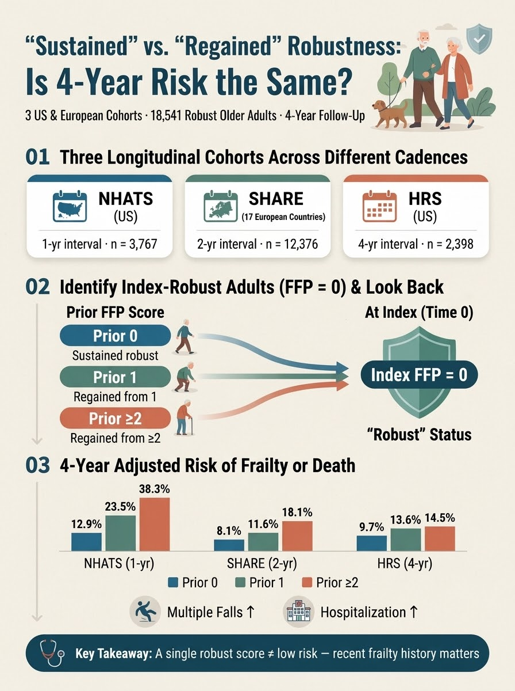

# Prior Frailty History and 4-Year Risk of Frailty or Death Among Robust Older Adults: A Multicohort Study

Does an older adult who regains a Fried frailty phenotype (FFP) score of 0 have the same four-year prognosis as someone who scored 0 at both visits?

We studied 18,541 adults aged 65 years or older who had an FFP score of 0 at the index visit. We grouped them by their score at the previous assessment (0, 1, or ≥2). The two assessments were approximately one year apart in the US National Health and Aging Trends Study (NHATS), two years apart in the Survey of Health, Ageing and Retirement in Europe (SHARE), and four years apart in the US Health and Retirement Study (HRS).

<p align="center">
  <a href="figures/graphical-abstract.jpeg"></a>
</p>

In NHATS, the adjusted four-year risk of frailty or death was **12.9%** for those who scored 0 at both visits, **23.5%** for those with a prior score of 1, and **38.3%** for those with a prior score of ≥2. The risk difference between the highest and lowest prior-score groups was 25.4 percentage points (95% CI, 18.9 to 33.2). The corresponding differences were 10.0 points in SHARE (95% CI, 7.1 to 13.0) and 4.7 points in HRS (95% CI, −0.3 to 11.7). In NHATS, higher prior scores also identified participants at greater risk of multiple falls and hospitalization.

## Data and code

This repository contains the analysis code for the study. The participant data are available through the respective cohort data portals.

<details>
<summary>Reproduce the analyses</summary>

Use Python 3.11 on macOS or Linux. Place the cohort files under a common data directory using their original release filenames.

| Cohort | Required files |
| --- | --- |
| NHATS | Round 1–14 Stata interview files and the round 14 tracker in their release folders under `NHATS/data/` |
| HRS | `HRS/randhrs1992_2022v1.dta` and the 2006–2022 Core archives in `HRS/Core/` |
| SHARE | Release 9.0.0 Stata files in `SHARE/wave_1/` through `SHARE/wave_9/`, plus `SHARE/wave_8_covid/`, `SHARE/wave_9_covid/`, and `SHARE/all_waves/` |

Run the following commands from the repository root, replacing `/path/to/data` with the directory containing the cohort folders.

```bash
python -m pip install -r requirements.txt
python -B run.py --raw-data /path/to/data --workers 4
```

The cohort estimates are written to `work/nhats/tables/`, `work/hrs/`, and `results/share/`. To regenerate the NHATS summaries and validate the saved cohort estimates, run `python -B run.py --export-only`.

To generate the HRS and SHARE baseline characteristics, run `python -B src/export_external_table1.py --raw-data /path/to/data`. The baseline tables are saved in `results/hrs_baseline/` and `results/share/`.

</details>
